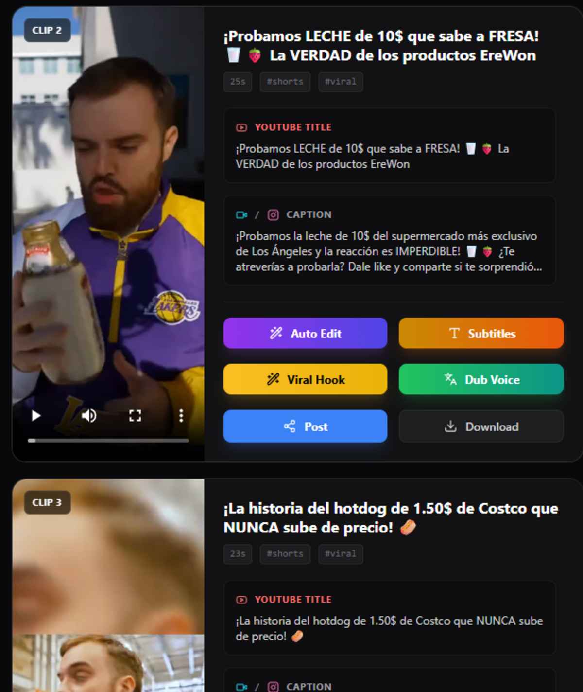
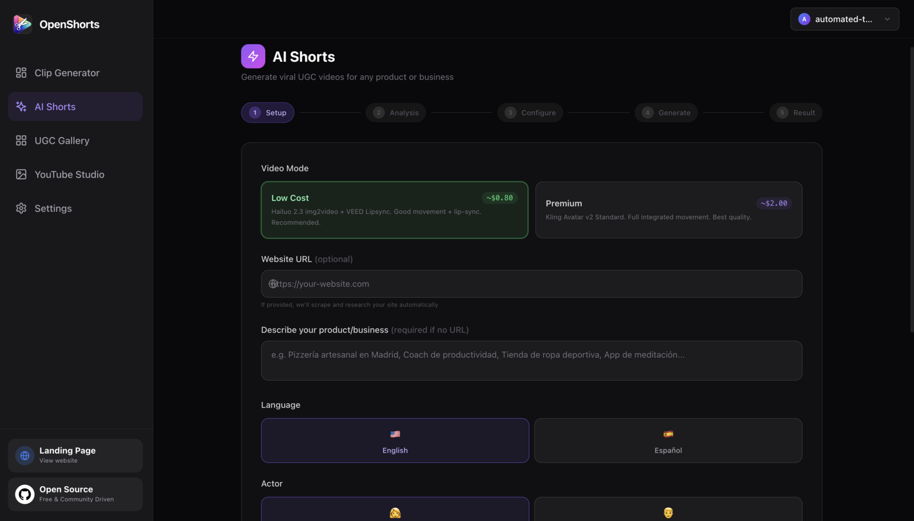
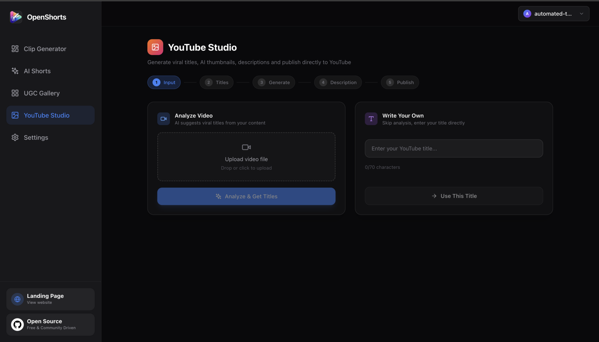

<h1>
  
  OpenShorts pour YunoHost
</h1>

Générateur de courtes verticales (shorts) assisté par IA : transcription, découpe et sous-titres automatiques. Ce paquet l'exécute en natif (Python + workers systemd), sans Docker.

**Version livrée :** voir manifest.toml

## Caractéristiques

- Pipeline natif Python + workers systemd
- Transcription (Whisper) et sous-titres automatiques
- Sortie MP4 verticale prête pour les plateformes de shorts
- Stockage des médias dans le data_dir de l'app

## Liens

- Projet amont : <https://github.com/quartztester/openshorts>
- Paquet YunoHost : <https://github.com/quartztester/openshorts_ynh>

## Screenshots

